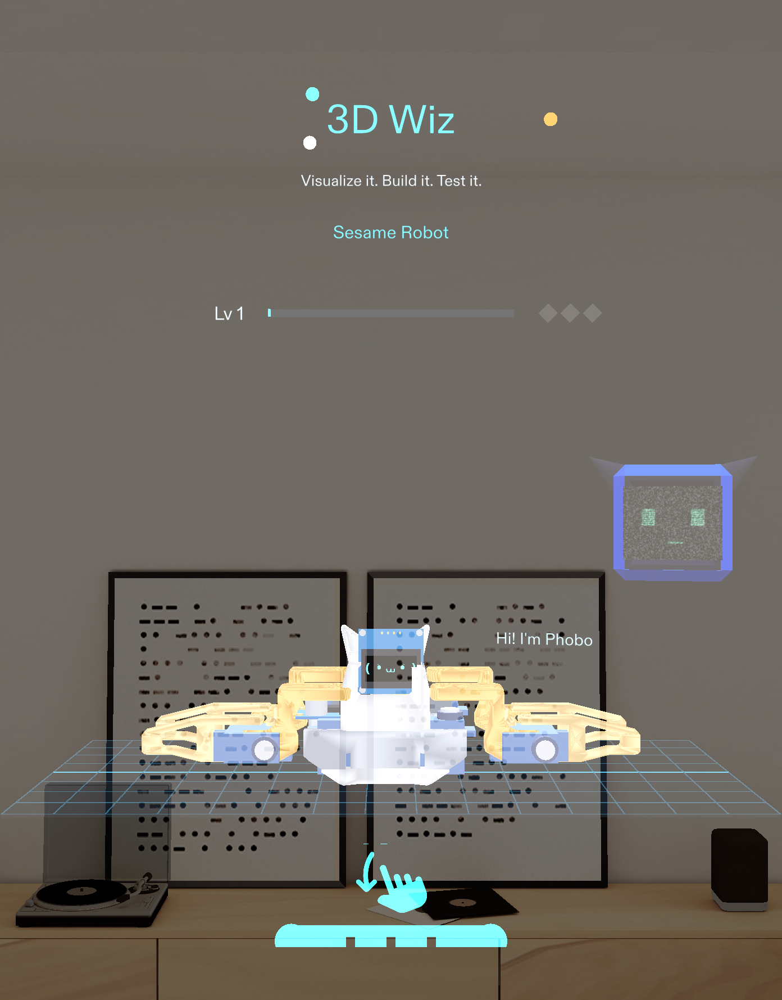
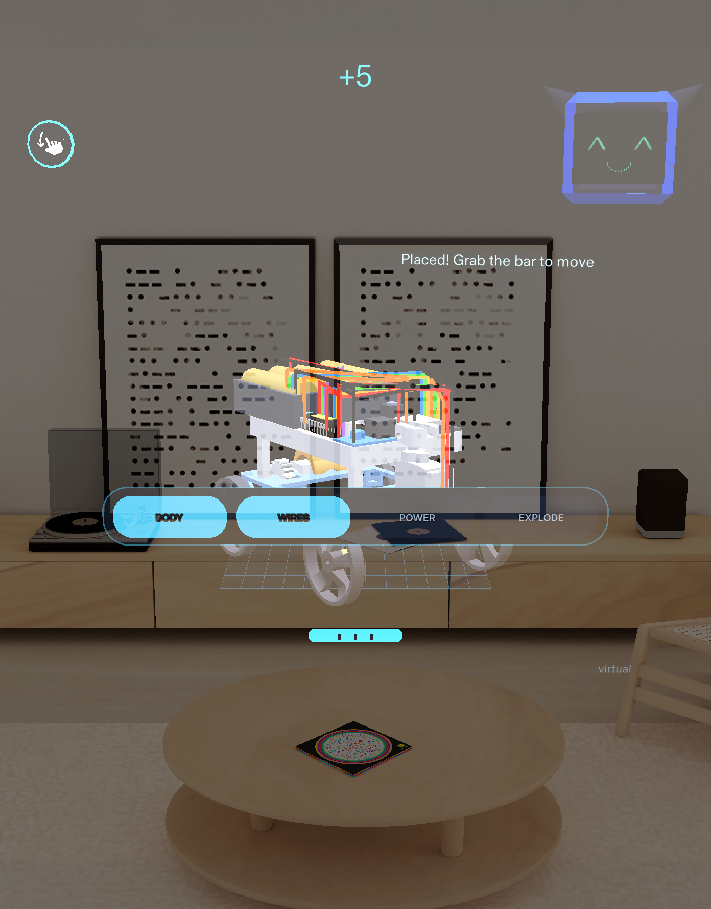
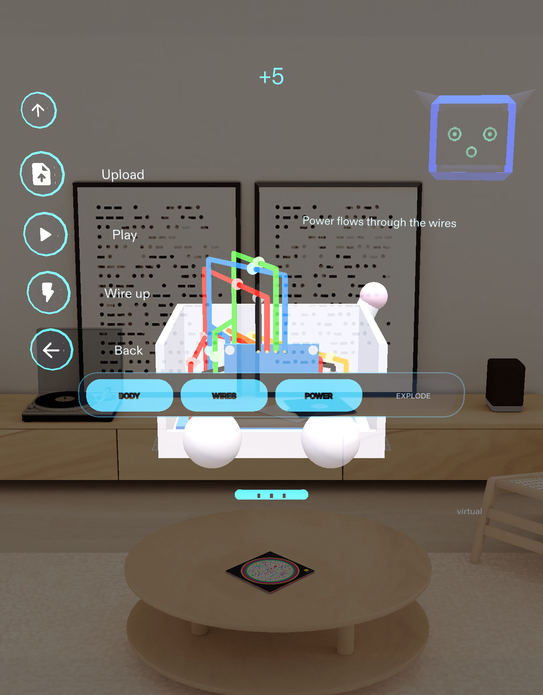
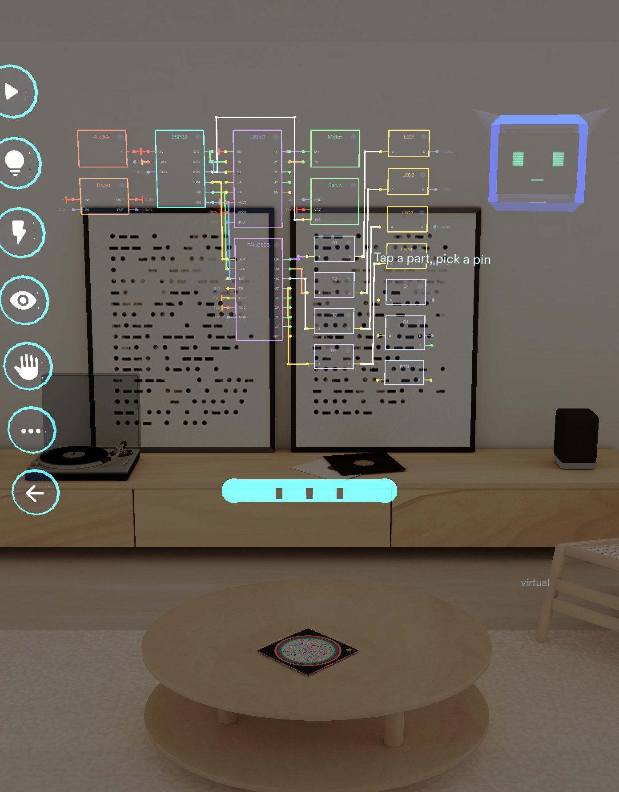

# 3D Wiz

**See a robot's circuit on the robot itself, in AR, before you print or buy anything.** A Snap Spectacles Lens (Lens Studio 5.23.2) for
Devpost *Learn AR with SPECS*. Bring a 3D model, put it on your table, and see its electronics mounted in it with every wire drawn between
the real pins. Then wire it up, drive it and test it, all virtually.

> Built and verified in the Lens Studio **preview** (SPECS 27, Interactive). It has not been run on real glasses.

## Screenshots (all from the Lens Studio preview)

| Title screen | Visualize: RC car on the table, power on |
|---|---|
|  |  |

| Visualize: Desk Pet (cat shell), a part selected | Wire up: KiCad-style diagram of the RC car |
|---|---|
|  |  |

## What it does

- **Visualize (the AR view).** The 3D object stands on your table, scaled to a readable size, with a see-through body. Every electronic
  part sits at its mount point and every wire of the project runs between the real pin positions of those parts.
  - **POWER** sends light pulses along the wires.
  - **WIRES / BODY / EXPLODE** are layer toggles; EXPLODE pulls the parts apart.
  - **Tap a part** to light it and its wires and read its name and size.
- **Table placement.** The first time you open Visualize a ring follows your gaze on a virtual table; pinch to place the model. It then
  stays where you put it while you look around. A grab bar under it moves it again. In the preview the table is a stand-in for real plane detection.
- **Head-following UI.** The menu, level bar and layer toggles follow where you look; the model and bench stay on the table.
- **Wire up.** A KiCad-style diagram of the circuit, a 3D breadboard view with jump wires, hands that assemble it, and a verified-pin check
  for projects without a simulator (the Desk Pet).
- **Play / Drive.** A small circuit simulator drives the virtual RC car from the wiring you made; other projects play scripted commands.
- **Phobo.** A companion bot with an analog-TV face that follows you, gives hints with quick chips (Why? / Next? / What?) and reacts to
  progress. Offline it answers from scripted hints. Optional AI answers use Snap's Remote Service Gateway (see below).
- **Gamified.** XP, levels, badges and sound effects.
- **Projects (the Library).** Sesame Robot, Desk Pet (cat shell), Obstacle Car, Servo Hand, Button LED, RC Car and **My Model** for your own
  FBX / OBJ / GLB or CAD (STL, STEP, IGES via `tools/cad`). Each project is one data pack read from a real open source; see `NOTICE`.

## Open it

1. Install **Lens Studio 5.23.2**.
2. Open `3D_Wiz_5.23.1.esproj`. Lens Studio regenerates `Cache/`, `Support/` and `Workspaces/`, which are not in this repository.
3. Make sure the Preview panel is on **SPECS 27 (Interactive)**. Press the swipe-hint icon (or drag it down) to open the menu.
4. Menu: the title shows **Visualize** and **Library**. Inside a scene: **Upload, Play, Wire up, Back**.

Packages are included in `Packages/` (Spectacles Interaction Kit, Spectacles UI Kit, Leaf, Remote Service Gateway and its dependencies).
If the preview says a script failed to compile after the first open, recompile once or reopen the project.

## Optional AI for Phobo

Open the `RemoteServiceGatewayCredentials` object in the scene and paste **your own** token in the Inspector. No key is stored in this
repository, and the Lens works without one (Phobo then uses its scripted hints). The AI path has not been tested.

## Tests

The LEAF scenarios in `Assets/Scripts/WizLeaf*.ts` drive the real colliders (c1 menu, c2 build, c3 wire game, c5 play, c6 save, c7 projects,
c8 packs, c9 My Model, c10 circuit lab, c11 drive, c12 Phobo / menu / placement, c13 pet verified pins, c14 AR visualize). Open the LEAF
panel in Lens Studio to run them. `x-ik-reachability` is a known failure: the simulated arm cannot reach the top menu icons.

## More

- [`README.project.md`](README.project.md): the full engineering notes (project packs, circuit simulator, limits). Parts of it describe
  the earlier Visualize workbench and menu, which this version replaced.
- [`devpost/`](devpost): design briefs and status notes.
- [`NOTICE`](NOTICE): credits and licences of every source used.
