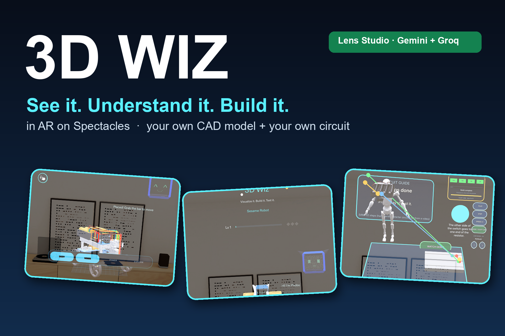
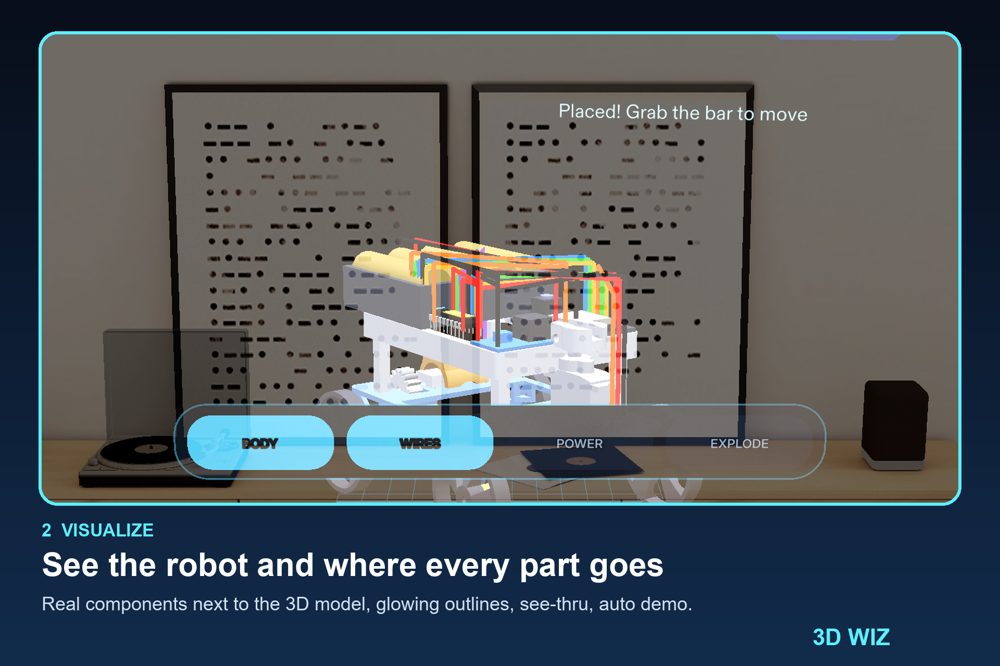
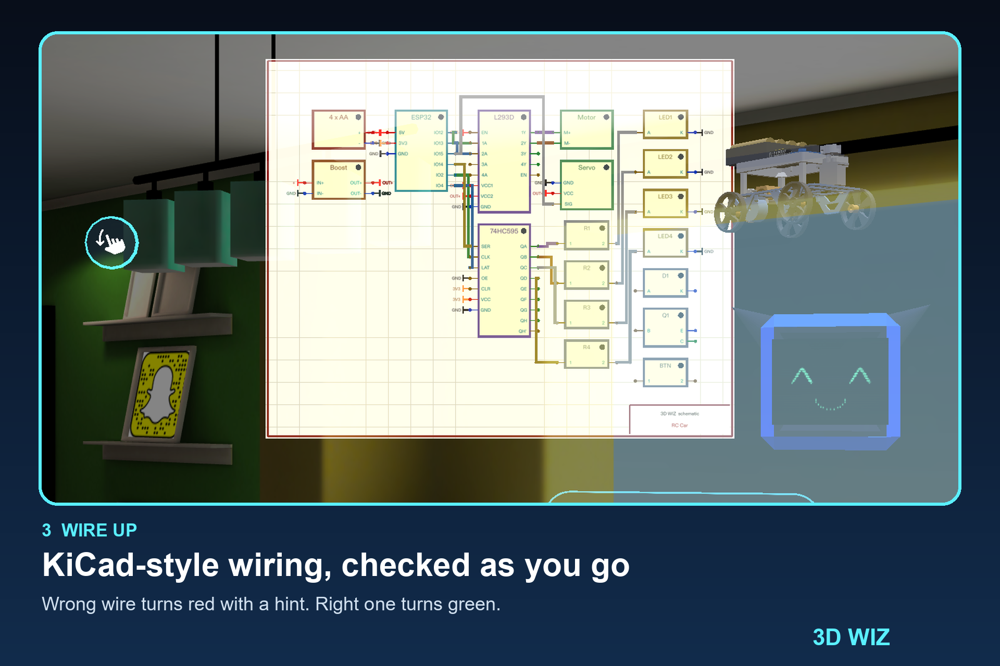
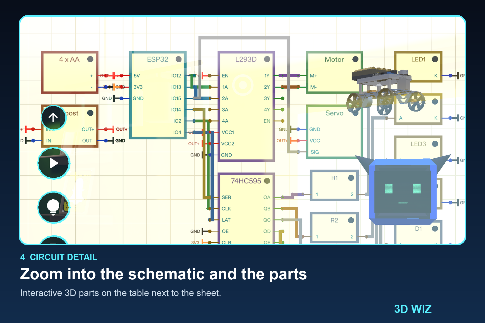
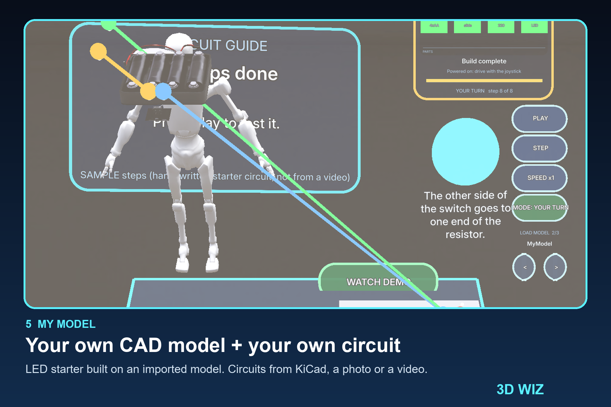

# 3D Wiz - Visualize it. Build it. Test it.

An AR workbench for Snap Spectacles (Lens Studio). See a robot and its circuit in AR before you build it, then build it step by step. Bring your own CAD model and your own circuit.

## Features
- **Visualize** - the real components next to the 3D model, with glowing outlines where each one goes. See-thru view, auto demo.
- **Analyse** - hover a part for an outline, tap it for an info card, press ASK MORE for a longer answer.
- **Build** - guided step-by-step build. The current step glows, a wrong part or wire turns red with a hint, a right one turns green. Explode / Assemble, auto-build demo, voice command, Play to test.
- **My Model** - pick your own 3D model (FBX / GLB / OBJ, or CAD converted to GLB) and a circuit, press START BUILD, and the parts are placed on your model. Starts with a simple **LED circuit** (battery, switch, resistor, LED).
- **Bring your own circuit** from a **KiCad file**, a **photo** of a circuit drawing, or a **tutorial video**.
- **Circuit Lab** - wire real component models yourself and test the circuit in a simple simulator.

| | |
|---|---|
|  |  |
|  |  |

## Run it
1. Open `3D_Wiz_5.23.1.esproj` in **Lens Studio 5.23.2** (Spectacles target, preview device: Spectacles).
2. Press play. Open the menu by clicking the hint icon in the preview (or sweep a hand down on glasses).
3. Pick **Visualize**, **Analyse**, **Build** or **My Model**.

Demo script with every button and the sample files: [`Showcase/DEMO_BUTTON_FLOW.md`](Showcase/DEMO_BUTTON_FLOW.md).

### Use your own model and circuit
- **Model:** run `tools/ImportMyModel.editor.ts` in Lens Studio (a Lens cannot open a file picker), then add the prefab to `CircuitGuide > userModels`. STEP/STL/IGES: convert first with `node tools/cad/ConvertCad.mjs part.step part.glb`.
- **KiCad:** `node tools/wrap-kicad.mjs your.kicad_sch`, then add the JSON in `Assets/GuidePacks/` to `CircuitGuide > circuitFiles`.
- **Photo:** set `CircuitGuide > circuitPhoto` and press **CONVERT PHOTO** on My Model (needs a Gemini key), or `node tools/media-to-circuit.mjs picture.png`.
- **Video:** `node tools/media-to-circuit.mjs video.mp4`, then add the JSON to `circuitFiles`.
- Samples to try: `Showcase/` (MicroD model, LED circuit JSONs, KiCad file, photo, video).

### Optional live AI (Gemini / Groq)
Off by default; the Lens works offline. To turn it on: copy `.env.example` to `.env`, add your key, run `powershell -ExecutionPolicy Bypass -File tools/apply-env.ps1`, then set `CircuitGuide > liveAi` ON. Clear the Inspector `geminiKey` before committing.

**API disclosure:** Google Gemini (photo/video to circuit, ASK MORE, step lists) and Groq (fast voice commands) are called only when `liveAi` is on and a key is set. Sent: your text and, for CONVERT PHOTO, the picture you assigned. Keys stay in `.env` or the Inspector and are never logged. Max 8 calls per session. AI output is checked against parts the Lens has 3D models for.

## Test it
Tests use **LEAF** (included in the project).
1. In the scene, enable the `LeafIndex` object (it is disabled by default).
2. Open the LEAF panel in Lens Studio and run a scenario, for example `g6-main-menu-routes`, `g18-led-and-imports` (LED starter + KiCad/photo import), or `c1-menu-and-gesture`. Each prints PASSED or FAILED in the Lens Studio log.
3. `x-photo-live` makes a real Gemini call and needs a key.
4. Simulator unit test: `node tools/tests/circuit-sim.test.mjs`.

## Limits
- Tested in the Lens Studio Spectacles preview only, not on real glasses or with real hand tracking.
- Only part types with 3D models are supported: LED, resistor, battery, switch, motor, servo, ESP32, L293D.
- KiCad import was tested on a hand-written KiCad 7 file, not on real exports.
- Video conversion runs as a tool outside the Lens.
- Groq is wired in but has not been tested live; Gemini has.
- Play is a simulation. A virtual pass does not prove a physical build works.

Credits and licences: [`NOTICE`](NOTICE). The long original README is kept as [`README.full.md`](README.full.md).
